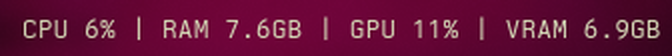

# perf-plugin

A personal Omarchy bar plugin: CPU, RAM, GPU and VRAM usage at a glance.



`CPU 6% | RAM 7.6GB | GPU 11% | VRAM 6.9GB`

This is my own plugin, not an official Omarchy widget and not listed in the
marketplace. The plugin id is `nickmdrummer.perf`.

## Shows

- **CPU** — busy share of all cores, sampled between refreshes (not the
  cumulative average since boot).
- **RAM** — used memory, with "used" taken from `MemAvailable` so reclaimable
  cache is not counted as pressure.
- **GPU** — utilisation from the card's own driver.
- **VRAM** — used video memory.

Hover for the fuller reading (used/total and percentage for memory). The text
turns to the theme's urgent colour at 90% or above. Left click opens `btop` in
a floating terminal.

## Install

```bash
omarchy plugin add https://github.com/NickmDrummer/perf-plugin.git --enable --yes
```

`omarchy plugin add` clones the repo into
`~/.config/omarchy/plugins/nickmdrummer.perf`, validates the manifest, then
places and enables the widget in the bar.

Manual install, if you prefer to clone it yourself:

```bash
git clone https://github.com/NickmDrummer/perf-plugin.git \
  ~/.config/omarchy/plugins/nickmdrummer.perf
omarchy plugin validate ~/.config/omarchy/plugins/nickmdrummer.perf
omarchy plugin enable nickmdrummer.perf --section right
```

Saving a file inside the plugin folder reloads it. A change to `Logic.js` may
keep the old module cached; `omarchy restart shell` clears it.

## How readings are taken

No helper scripts and no polling daemon: the widget reads the files the kernel
already maintains, once per second.

| Metric | Source |
|---|---|
| CPU | `/proc/stat` (delta between samples) |
| RAM | `/proc/meminfo` (`MemTotal`, `MemAvailable`) |
| GPU (AMD) | `/sys/class/drm/card*/device/gpu_busy_percent` |
| VRAM (AMD) | `/sys/class/drm/card*/device/mem_info_vram_used` and `mem_info_vram_total` |
| GPU/VRAM (NVIDIA) | `nvidia-smi --query-gpu=utilization.gpu,memory.used,memory.total` |

The GPU backend is detected once at startup. AMD needs nothing installed; the
NVIDIA path only spawns `nvidia-smi` when the driver is loaded
(`/proc/driver/nvidia/version`). On a machine with no readable GPU the metric is
simply omitted.

## Settings

Configured per widget instance from the bar settings, or inline in
`~/.config/omarchy/shell.json`:

| Key | Type | Default | Meaning |
|---|---|---|---|
| `cpu` | boolean | `true` | Show CPU |
| `ram` | boolean | `true` | Show RAM |
| `gpu` | boolean | `true` | Show GPU |
| `vram` | boolean | `true` | Show VRAM |
| `interval` | integer (500–5000 ms) | `1000` | Refresh interval |

From the command line:

```bash
omarchy bar set nickmdrummer.perf interval 500
omarchy bar set nickmdrummer.perf vram false
omarchy bar get nickmdrummer.perf interval
```

## Update and remove

```bash
omarchy plugin update nickmdrummer.perf
omarchy plugin disable nickmdrummer.perf
omarchy plugin remove nickmdrummer.perf --yes
```

## Notes

- The first CPU reading after load shows `—`: a percentage needs two samples.
- On a vertical bar the labels are dropped and the values stack, since the bar
  is only 28px wide; the tooltip still names each one.
- The bar is built per monitor, so each screen keeps its own timer. The reads
  are a few kilobytes from procfs and sysfs and never fork on AMD.

## Development

`Logic.js` holds the parsers and formatters and is free of QML, so it runs under
Node:

```bash
node --test tests/
```

## License

MIT. See [LICENSE](LICENSE).
